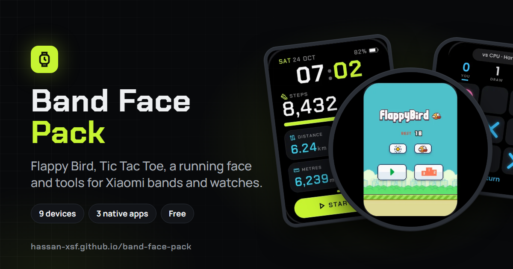
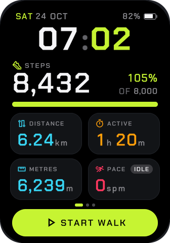
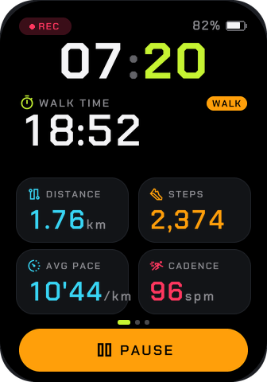
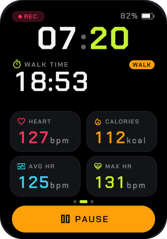
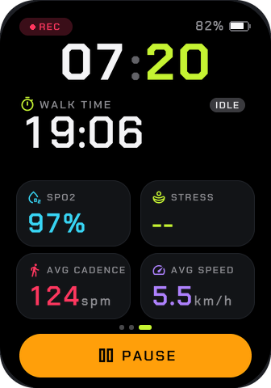
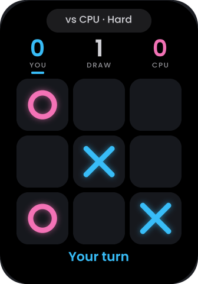
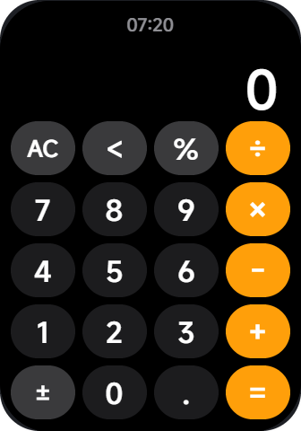
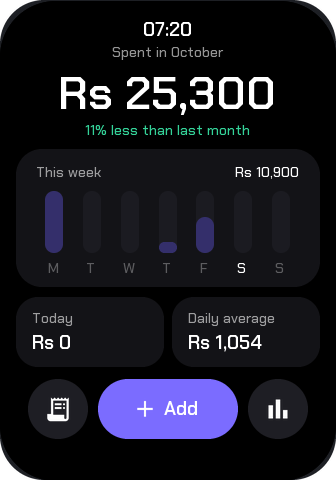
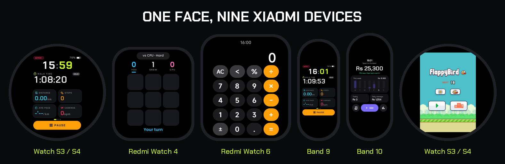

<div align="center">



# Mi Band 10 Pro Faces

**A fitness tracker face, Flappy Bird, Tic Tac Toe, a calculator and an expense tracker, built for the Xiaomi Smart Band 10 Pro
and ported to 9 Xiaomi bands and watches.**
Free and open source. Install them with Gadgetbridge, with no modded apps and no root.

[](#compatibility)
[](#compatibility)
[](INSTALL.md)
[](LICENSE)

[**Download**](../../releases/latest) · [Install guide](INSTALL.md) · [Preview in your browser](#preview-before-installing) · [Credits](#credits)

</div>

---

## The faces

### 🏃 Stride: running and walking

The home screen for people who move. You get the time, steps against your goal, distance, active time and a live pace, with
heart rate, calories, SpO₂, stress, sleep and stand on the next pages. Tap the tiles to flip between them.

Press **Start Walk** to begin a session. It counts walk time, distance, steps, average pace and cadence. You can pause,
resume and end it. During a session every health value is a **fresh reading taken after you pressed Start**, not the
day's leftovers: calories burned, average and max heart rate, SpO₂, stress, average cadence and speed.

<p align="center">
  
  
  
  
</p>

### 🐤 Flappy Bird
The real thing, with the original sprites. Tap to flap. Your best score, day or night theme and bird colour are saved.

### ⭕ Tic Tac Toe
Play the CPU on Easy or Hard (Hard never loses), or play a friend. Scores are kept.

### 🧮 Calculator
A clean, phone-style calculator with percent, sign toggle and repeat equals.

### 💸 Expenses
Track spending from your wrist: amount → category → note. It shows today, this week as a bar chart, this month compared
with last month, and every past month with a category split. Currency is Rs.

<p align="center">
  
  
  
  
</p>

### 📱 Native apps (bonus)
Flappy Bird, Tic Tac Toe and Calculator are also built as **real apps**. They appear in the band's app list next to the
stock apps, so you keep your normal watchface.

---

## Install

> First time? Follow the **[full install guide](INSTALL.md)**. You need the band's auth key once.

1. Download the `.face` for **your device** from **[Releases](../../releases/latest)**, or from [`faces/`](faces).
2. Send it to your phone and open it with **Gadgetbridge** → **Install**.
3. On the band, long-press the watchface, swipe to the new one and tap it.

Pick the folder for your device. Each has the same five faces: `lua_stride`, `lua_flappy`, `lua_tictactoe`,
`lua_calculator` and `lua_expenses` (with a `_<device>` suffix outside `band10pro/`).

| Folder | Device | Screen |
|---|---|---|
| [`faces/band10pro/`](faces/band10pro) | Mi Band 10 Pro, plus native apps in [`apps/`](faces/band10pro/apps) | 336 × 480 |
| [`faces/band9pro/`](faces/band9pro) | Mi Band 9 Pro | 336 × 480 |
| [`faces/band8pro/`](faces/band8pro) | Mi Band 8 Pro | 336 × 480 |
| [`faces/band10/`](faces/band10) | Mi Band 10 | 212 × 520 |
| [`faces/band9/`](faces/band9) | Mi Band 9 | 192 × 490 |
| [`faces/redmiwatch4/`](faces/redmiwatch4) | Redmi Watch 4 | 390 × 450 |
| [`faces/redmiwatch6/`](faces/redmiwatch6) | Redmi Watch 6 | 432 × 514 |
| [`faces/watchs3/`](faces/watchs3) | Xiaomi Watch S3 | 466 round |
| [`faces/watchs4/`](faces/watchs4) | Xiaomi Watch S4 | 466 round |

**Native apps:** install the face, open it on the band and tap **Install**. The app copies itself into the app list.
Then switch it **On** once in **Settings → Manage apps**.

Every face keeps the band usable: long-press and swipe still work, so you can always switch away.

## Compatibility

<p align="center"></p>

| Device | Status |
|---|---|
| **Mi Band 10 Pro**, Global 3.201.026 | ✅ Everything tested on the band |
| Mi Band 10 Pro, Global 3.201.016 / China 3.101.043 | 🟡 Lua faces should work. Native apps are built from m0tral's firmware maps but **untested** |
| **Mi Band 9 Pro**, **Mi Band 8 Pro** | 🟡 Same 336 × 480 screen and Lua engine, so the faces are unchanged. **Untested** |
| **Redmi Watch 4**, **Redmi Watch 6** | 🟡 Auto-scaled to the screen (94% / 107%). **Untested** |
| **Xiaomi Watch S3**, **Watch S4** | 🟡 Auto-scaled to fit inside the round screen (84%). **Untested** |
| **Mi Band 9**, **Mi Band 10** | 🟡 Auto-scaled to the narrow screen (57% / 63%). Everything works, but small text is small. **Untested** |
| Phone | Android with [Gadgetbridge](https://gadgetbridge.org/). Check that it [supports your device](https://gadgetbridge.org/gadgets/). The official Mi Fitness app can't install custom faces. |

**How the ports work:** every face is designed at 336 × 480. [`port/`](port) scales its art to the target screen
and adds a small Lua layer that scales every position, size and font the face asks for, then centres it. The face
code itself is unchanged, so fixes reach every device at once. All ports were checked in
[Band Viewer](https://github.com/hassan-xsf/band-viewer) at their real screen size and shape.

Native apps are Band 10 Pro only. Non-Xiaomi watches (Amazfit, Wear OS, Huawei) use completely different systems.

Tried it on a 🟡 device? **[Tell us how it went](../../issues/new/choose)**, even "works fine" helps.

## FAQ

<details>
<summary><b>Is Stride's distance accurate?</b></summary>

It is estimated from steps × stride length (0.74 m by default), and active time comes from your step count. For a better
match, set `STRIDE_M` in [`src/wf_lua_stride/app/lua/main.lua`](src/wf_lua_stride/app/lua/main.lua) to your own stride
(roughly height × 0.415 for walking) and rebuild.
</details>

<details>
<summary><b>Why no blood pressure?</b></summary>

The Band 10 Pro has no blood pressure sensor. Stride shows everything the band actually measures.
</details>

<details>
<summary><b>The face shows "--" for SpO₂ or stress during a walk</b></summary>

That's on purpose. It waits for a reading taken *after* you pressed Start. Run a measurement on the band, or wait for
the next automatic one.
</details>

<details>
<summary><b>I'm stuck on a face and can't swipe away</b></summary>

In Gadgetbridge → watchface manager, tap any other face → **Set**. See [INSTALL.md](INSTALL.md#getting-off-a-broken-watchface).
</details>

## Preview before installing

Open any `.face` in **[Band Viewer](https://github.com/hassan-xsf/band-viewer)**: it runs Mi Band 10 Pro
faces in your browser, with fake health data, taps and long-presses.

## Build from source

You need Windows, the [EasyFace](https://github.com/m0tral/EasyFace) compiler v4.23, and Python 3 with Pillow.

```powershell
python src\wf_lua_stride\gen_assets.py                     # re-render art (only if you changed it)
.\build_face.ps1 src\wf_lua_stride -Compiler C:\path\to\Compiler.exe
# -> build\lua_stride.face
.\build_face.ps1 src\wf_lua_stride -Device redmiwatch4      # port to another device
# -> build\lua_stride_redmiwatch4.face
```

Devices: `band10pro` `band9pro` `band8pro` `band10` `band9` `redmiwatch4` `redmiwatch6` `watchs3` `watchs4`.
`python port\port.py --check` prints the scale used for each one.

```
src/wf_lua_<name>/
├── app/lua/main.lua     the face (Lua + lvgl)
├── app/lua/*.png        pre-rendered art and glyph fonts
├── gen_assets.py        renders that art from fonts/
├── *_test.lua           PC tests (lua <name>_test.lua)
└── module.fprj          EasyFace project
```

Issues and pull requests are welcome.

## Credits

This project stands on other people's work. Thank you:

- **[m0tral](https://github.com/m0tral)**: the [native app platform](https://github.com/m0tral/MiWatchNativeApps) and its
  firmware **3.201.026** support that the native apps are built on, the [EasyFace](https://github.com/m0tral/EasyFace)
  compiler, and the [Lua watchface examples](https://github.com/m0tral/MiWatchLuaWatchfaces) that documented the
  band's Lua API. Follow his work: [Telegram news](https://t.me/mi_watch_news) · [chat](https://t.me/mi_watch_int).
- **Flappy Bird**: the original game by Dong Nguyen (.GEARS). Sprites from
  [samuelcust/flappy-bird-assets](https://github.com/samuelcust/flappy-bird-assets), and the UI atlas (buttons, panel, medals) from
  [mrspeaker/wafty-man](https://github.com/mrspeaker/wafty-man).
- [Gadgetbridge](https://gadgetbridge.org/) for open-source installing, and
  [Xiaomi Cloud Tokens Extractor](https://github.com/PiotrMachowski/Xiaomi-cloud-tokens-extractor) for the auth key.
- Fonts: Chakra Petch, Poppins (SIL OFL) and Material Symbols (Apache 2.0). See [fonts/](fonts/README.md).

See [THIRD_PARTY_NOTICES.md](THIRD_PARTY_NOTICES.md) for licenses.

## License

My code is under [MIT](LICENSE). Flappy Bird's name and art belong to their owners and are included for personal,
non-commercial use. If you're a rights holder and want them removed, open an issue.

<div align="center"><sub>Made by <a href="https://github.com/hassan-xsf">Hassan</a>. If a face made your band better, a ⭐ helps others find it.</sub></div>
